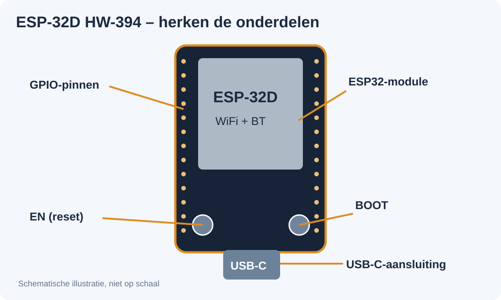
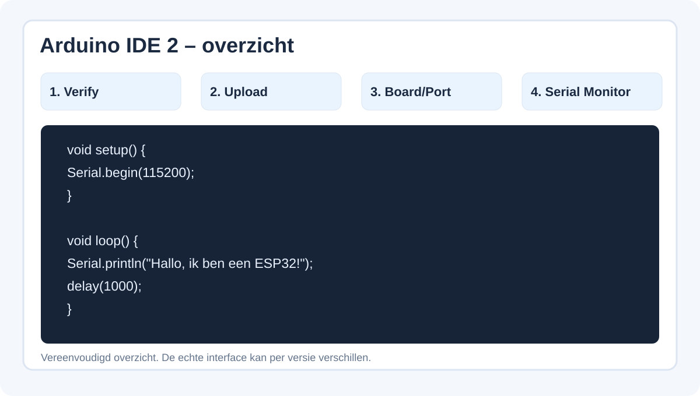
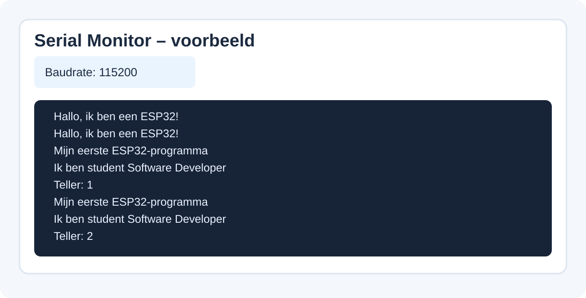

# Les 1 – Kennismaken met de ESP32

**Smart Technology · Software Developer niveau 4 · 90 minuten**  
**Hardware:** ESP-32D WiFi+BT (HW-394, USB-C)

## 🎯 Leerdoelen

Na deze les kun je:

- uitleggen wat een microcontroller is en waarvoor je deze kunt inzetten;
- GPIO, GND, 3V3, USB-C, wifi en Bluetooth op hoofdlijnen herkennen;
- de Arduino IDE gebruiken om een programma te controleren en te uploaden;
- uitleggen wat `setup()` en `loop()` doen;
- uitvoer bekijken in de seriële monitor en eenvoudige code aanpassen.

## 📖 Introductie

Een Software Developer maakt niet alleen programma's voor websites en computers. Software kan ook **fysieke apparaten** aansturen. Denk aan een slimme plantenmonitor, een afstandsalarm of een lamp die je later via Bluetooth bedient.

Je gebruikt in deze lessen de **ESP-32D WiFi+BT**. Op het bord zitten onder andere een ESP32-microcontroller, een USB-C-aansluiting, twee knoppen (EN en BOOT) en aansluitpinnen voor sensoren en LED's. Wifi en Bluetooth zijn ingebouwd; die gebruiken we in latere lessen.

**Benodigd:** ESP-32D-board, USB-C-**datakabel**, je eigen laptop met Arduino IDE 2 en internet (voor de installatie).



*Afbeelding 1. Schematische weergave van het ESP-32D-lesboard: USB-C, GPIO, EN en BOOT.*

> [!NOTE]
> Vandaag sluiten we nog geen LED of sensor aan. Je leert eerst hoe je software op de ESP32 krijgt en hoe je de werking controleert.

## 💡 Theorie

### Wat is een microcontroller?

Een microcontroller is een programmeerbare chip die een eigen programma uitvoert. Een ESP32 kan bijvoorbeeld een sensor uitlezen en afhankelijk van de meting een apparaat aansturen.

| Begrip | Wat betekent het? |
|---|---|
| GPIO | Een pin die je kunt gebruiken voor digitale invoer of uitvoer |
| 3V3 | 3,3-volt-aansluiting op het bord |
| GND | Elektrisch referentiepunt (ground) |
| USB-C | Voeding en dataoverdracht om de ESP32 te programmeren |
| Wifi | Draadloze communicatie via een netwerk |
| Bluetooth | Directe draadloze communicatie met apparaten in de buurt |
| Sketch | Een Arduino-programma, meestal opgeslagen als .ino |
| Serial Monitor | Een venster dat tekstberichten van het board toont |

### Arduino-code bestaat uit twee belangrijke functies

- `setup()` wordt eenmaal uitgevoerd als het programma begint (ook na een reset).
- `loop()` wordt daarna steeds opnieuw uitgevoerd.

Je kent waarschijnlijk al variabelen en functies. In Arduino-code gebruiken we C++-syntaxis: accolades, puntkomma's en functienamen.

## 🛠️ Opdracht

### Stap 1 – Arduino IDE 2 installeren (indien nodig)

1. Download Arduino IDE 2 via [de officiële Arduino-website](https://www.arduino.cc/en/software).
2. Open de instellingen (*File → Preferences* of op macOS *Arduino IDE → Settings*).
3. Vul bij **Additional Boards Manager URLs** deze URL in:

   `https://espressif.github.io/arduino-esp32/package_esp32_index.json`

4. Open de **Boards Manager** en installeer **esp32 by Espressif Systems**.

> [!TIP]
> Werk op je eigen laptop. Als Arduino IDE en het ESP32-boardpakket al geïnstalleerd zijn, kun je deze installatiestap overslaan.



*Afbeelding 2. Vereenvoudigd overzicht van Verify, Upload, Board/Port en Serial Monitor.*

### Stap 2 – Je board selecteren

1. Sluit het board met een USB-C-datakabel aan.
2. Selecteer onder **Tools → Board** de optie **ESP32 Dev Module**.
3. Selecteer onder **Tools → Port** de poort van jouw board.

> [!WARNING]
> Verschijnt er geen poort? Controleer eerst de datakabel. De ESP-32D HW-394 gebruikt een CH340C USB-serieel-chip: soms is hiervoor een stuurprogramma nodig. Vraag zo nodig de docent om hulp. Sluit deze les nog geen draden aan op de 3V3- of GPIO-pinnen.

### Stap 3 – Je eerste programma

Maak in Arduino IDE een nieuwe sketch en voer deze code in:

```cpp
void setup() {
  Serial.begin(115200);
}

void loop() {
  Serial.println("Hallo, ik ben een ESP32!");
  delay(1000);
}
```

**Wat gebeurt er?**

- `Serial.begin(115200);` start de seriële communicatie met 115200 baud.
- `Serial.println(...)` stuurt een tekstregel naar de computer.
- `delay(1000);` wacht 1000 milliseconden: één seconde.

**Test je programma:**

1. Klik op **Verify** (vinkje) en herstel eventuele syntaxfouten.
2. Klik op **Upload** (pijltje).
3. Open **Serial Monitor** en selecteer **115200 baud**.
4. Je ziet nu telkens:

```text
Hallo, ik ben een ESP32!
Hallo, ik ben een ESP32!
Hallo, ik ben een ESP32!
```



*Afbeelding 3. Voorbeeld van de tekstuitvoer in de Serial Monitor bij een baudrate van 115200.*

### Stap 4 – Zelfstandig aanpassen

**Opdracht A (verplicht):** zorg dat deze twee regels elkaar steeds afwisselen en dat er **twee seconden tussen de regels** zit:

```text
Mijn eerste ESP32-programma
Ik ben student Software Developer
```

**Opdracht B (verplicht):** maak een `int teller = 0;`, verhoog deze bij iedere uitvoering van `loop()` en laat de teller verschijnen:

```text
Teller: 1
Teller: 2
Teller: 3
```

Gebruik `Serial.print()`, `Serial.println()` en `teller++`. Combineer opdracht A en B in één sketch.

## ⭐ Bonusopdracht

Maak zelf een functie `toonBericht()` die de teller en het bericht **De ESP32 werkt!** afdrukt. Roep die functie aan vanuit `loop()`.

> [!TIP]
> Krijg je foutmeldingen? Kijk eerst naar de eerste duidelijke foutmelding, de puntkomma's en accolades. Controleer bij uploadproblemen de poort en USB-kabel.

## 💻 GitHub

**Optioneel:** wil je je werk ook bewaren op GitHub? Maak dan een map `smart-technology/les-01` in je eigen repository en zet daarin je sketch `les1_esp32.ino`. Voor deze les hoef je niets naar GitHub te pushen.

**Let op:** push geen wachtwoorden of persoonlijke gegevens naar GitHub.

## 🤖 AI-opdracht

Vraag een AI-assistent uit te leggen wat `setup()` en `loop()` doen. Vergelijk die uitleg met de theorie uit deze les. **Controleer de uitleg zelf:** wat gebeurt er als je op de knop EN (reset) drukt? Bespreek met een medestudent of de uitleg klopt. Je hoeft hierover niets in te leveren.

## 🧠 Reflectie

Bespreek kort met een medestudent:

1. Wat was het lastigste onderdeel?
2. Wat is het verschil tussen `Serial.print()` en `Serial.println()`?
3. Waarom staat de teller in `loop()`?

Je hoeft deze antwoorden niet schriftelijk in te leveren.

## 📤 Inleveren

**Lever slechts één bestand in:** `les1_esp32.ino` via de Canvas-opdracht van les 1.

Zorg dat je programma:

1. zonder fouten naar de ESP32 kan worden geüpload;
2. de twee aangepaste berichten met twee seconden ertussen afwisselend toont;
3. een teller toont die bij iedere `loop()` omhooggaat.

**Laat tijdens de les je werkende seriële monitor aan de docent zien.**

> [!NOTE]
> Geen screenshot, geen schriftelijke reflectie en geen GitHub-upload nodig voor deze eerste les. De bonusopdracht is vrijwillig.

## 🧠 Kennischeck

1. Wat is een microcontroller?
2. Wat doet `setup()` en wat doet `loop()`?
3. Wat gebeurt er bij `delay(2000)`?
4. Waarom moeten de baudrates van code en Serial Monitor overeenkomen?
5. Wat is het verschil tussen wifi en Bluetooth?

## 📚 Samenvatting

Je hebt geleerd wat een ESP32 doet, hoe je Arduino IDE gebruikt, hoe je een programma uploadt en hoe je met de seriële monitor controleert of je code werkt. In **les 2** sluit je een externe LED en weerstand aan om je eerste fysieke schakeling aan te sturen.
